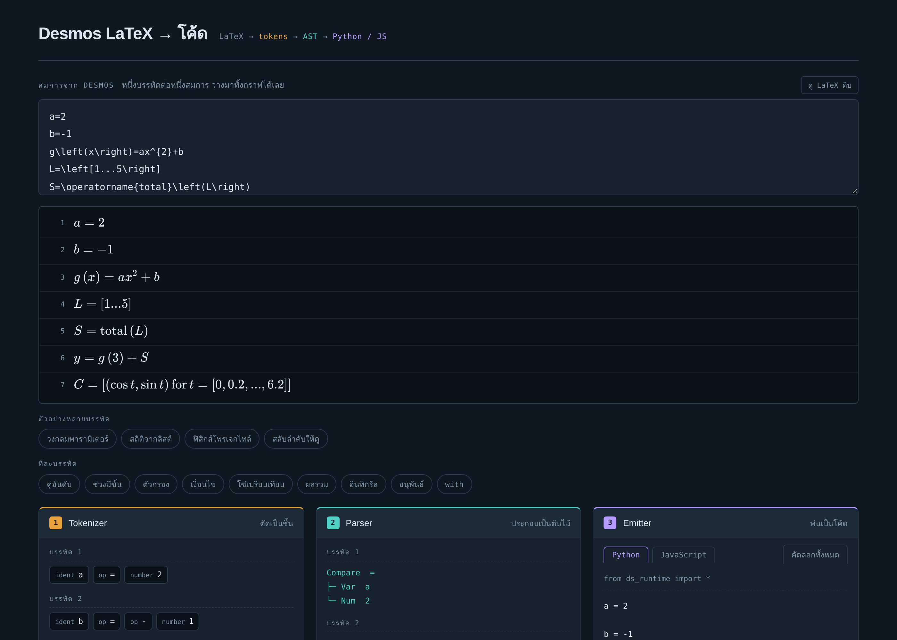

# Desmos LaTeX → Code



**คอมไพเลอร์ขนาดเล็กที่แปลงสมการจาก Desmos ให้กลายเป็นโค้ด Python (NumPy) หรือ JavaScript ที่รันได้จริง**
*A small compiler that turns Desmos graphing-calculator expressions into runnable Python (NumPy) or JavaScript.*

คัดลอกสมการจาก Desmos มาวางได้ทั้งกราฟ (หนึ่งบรรทัดต่อหนึ่งสมการ) แล้วดูได้ทีละขั้นว่าคอมไพเลอร์ทำงานอย่างไร
ตั้งแต่ตัดข้อความเป็นชิ้น ประกอบเป็นต้นไม้ไวยากรณ์ จนพ่นออกมาเป็นโค้ด

```
LaTeX  →  tokens  →  AST  →  Python / JavaScript
        Tokenizer   Parser     Emitter
```

## ตัวอย่าง

สมการใน Desmos

```latex
a=2
b=-1
g\left(x\right)=ax^{2}+b
L=\left[1...5\right]
S=\operatorname{total}\left(L\right)
y=g\left(3\right)+S
C=\left[\left(\cos t,\sin t\right)\operatorname{for}t=\left[0,0.2,...,6.2\right]\right]
```

กลายเป็น Python

```python
from ds_runtime import *

a = 2
b = -1

def g(x):
    return a * x ** 2 + b

L = rng(1, 5)
S = total(L)
y = g(3) + S
C = dfor(lambda t: pt(cos(t), sin(t)), rng(0, 6.2, 0.2))
```

รันแล้วได้ `y = 32`, `S = 15` ตรงกับที่ Desmos คำนวณ

## จุดที่น่าสนใจ

- **เขียนคอมไพเลอร์เองทั้งหมด** — tokenizer, recursive-descent parser และ code emitter โดยไม่ใช้ไลบรารี parser
- **จัดลำดับบรรทัดให้อัตโนมัติ** — Desmos ใช้ตัวแปรก่อนนิยามได้ แต่ Python ไม่ได้ คอมไพเลอร์จึงไล่ว่าบรรทัดไหนพึ่งบรรทัดไหน (dependency graph) แล้วเรียงใหม่ให้ถูก
- **ลิสต์คำนวณทั้งก้อนแบบ Desmos** — runtime ฝั่ง Python ใช้ NumPy ทำให้ลิสต์ broadcast ได้เหมือนใน Desmos
- **เห็นทุกขั้นตอน** — หน้าเว็บแสดง tokens, ต้นไม้ AST และโค้ดผลลัพธ์คู่กัน เหมาะใช้อธิบายการทำงานของคอมไพเลอร์

## รองรับ

เลขคณิต · `\frac` `\sqrt` · ตรีโกณ · `\ln` `\log_b` `\exp` · `|x|` · ตัวห้อย · อักษรกรีก ·
คู่อันดับและ `.x` `.y` · ลิสต์ · ช่วง · ดัชนีและตัวกรอง · `for` · `with` · ฟังก์ชันเป็นช่วง (piecewise) ·
โซ่เปรียบเทียบ · `\sum` `\prod` `\int` · อนุพันธ์ · แฟกทอเรียล · ฟังก์ชันลิสต์ · ฟังก์ชันหลายตัวแปร · แอ็กชัน `\to`

**ยังไม่รองรับ** — regression `~` · ticker · เมทริกซ์ · จำนวนเชิงซ้อน

## ไฟล์

```
index.html          หน้าเว็บ: ช่องวางสมการ + แสดง Tokenizer / Parser / Emitter
latex-compiler.js   ตัวคอมไพเลอร์ (tokenize → parse → emit)
ds_runtime.py       ฟังก์ชันช่วยสำหรับโค้ด Python ที่ได้ (NumPy)
ds-runtime.js       ฟังก์ชันช่วยสำหรับโค้ด JavaScript ที่ได้
```

## วิธีใช้

1. เปิด `index.html` ในเบราว์เซอร์ (ไม่ต้องติดตั้งอะไร)
2. วางสมการจาก Desmos ลงในช่อง หรือกดตัวอย่างด้านล่าง
3. เลือก Python หรือ JavaScript แล้วกด "คัดลอกทั้งหมด"
4. วางโค้ดไว้โฟลเดอร์เดียวกับ `ds_runtime.py` / `ds-runtime.js` แล้วรันได้เลย

```bash
pip install numpy
python my_graph.py
```

## ผู้พัฒนา

Soravis — [@SoravisLNH](https://github.com/SoravisLNH)
